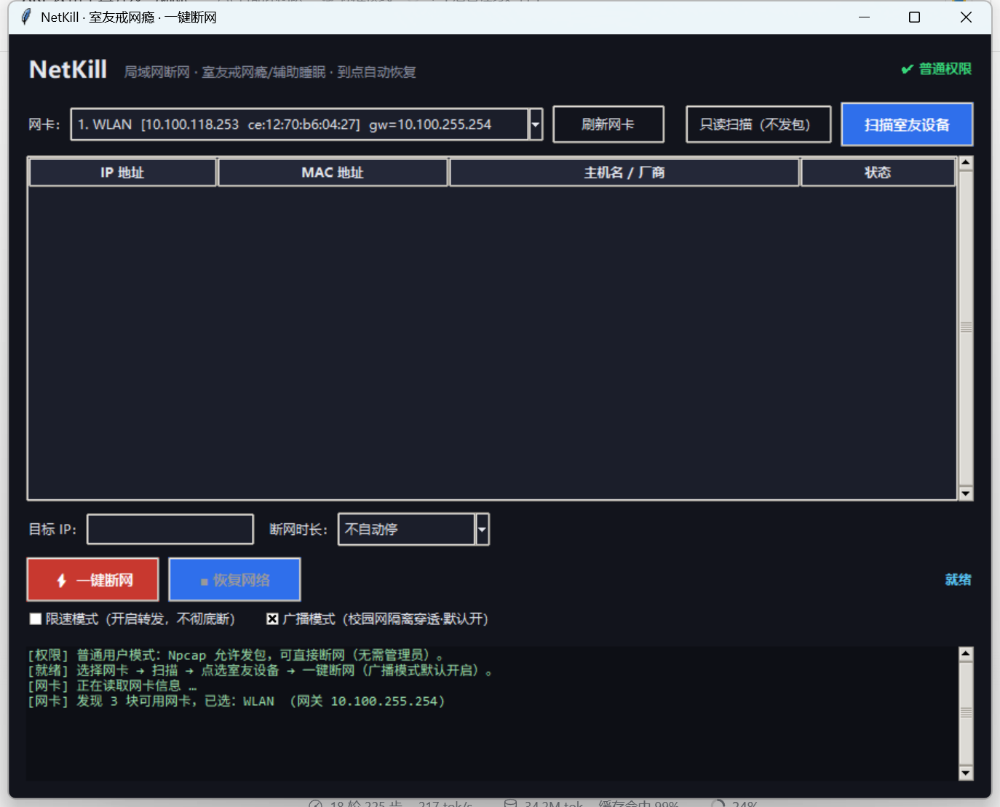

# NetKill

> 一键让局域网里的指定设备断网，帮助室友戒网瘾、辅助睡眠。



## 功能

- **一键断网** — 选中室友的设备，点一下开始，对方 Wi-Fi 显示已连接但无法上网
- **定时自动恢复** — 可选 5 分钟 / 15 分钟 / 30 分钟 / 1 小时 / 2 小时 / 自定义，到点自动恢复，不怕忘了
- **手动恢复** — 随时点「恢复网络」，立刻让对方网络复原
- **设备扫描** — 自动列出同一网络下的设备，点选即可，无需手动填 MAC
- **自动展开真实 MAC** — 扫描后自动识别设备的真实 MAC、厂商（如 Apple / 小米 / Intel）和设备类型（手机 / 电脑 / 电视）
- **分组列表** — 按「同一 AP 的设备」和「组播发现的设备」分组显示，一目了然
- **实时扫描** — 勾选后每 5 秒自动刷新设备列表
- **网络探测** — 探测指定设备当前是否还有网络（ARP / Ping / 端口），断网前后可对比
- **设备详情** — 右键或双击查看完整信息（IP、MAC、厂商、主机名、识别结果）
- **取消操作** — 扫描 / 探测过程中可随时停止
- **限速模式** — 不做彻底断网，改为转发模式，适合只想"卡一卡"的场景
- **广播模式** — 默认开启，专为校园网 / 宿舍网环境优化
- **自我保护** — 本机和网关永远在保护名单里，不会被误选；关窗口、断网到时、程序退出都会自动恢复

## 系统要求

| 项目 | 要求 |
|---|---|
| 系统 | Windows 10 / 11 |
| 运行环境 | Python 3.9+ |
| 网络驱动 | Npcap |
| 网络环境 | 你和室友的设备连在同一个局域网（同一台路由器 / 同一个 Wi-Fi） |

## 安装

1. 安装 **Python 3.9+**：<https://www.python.org/downloads/>（安装时勾选 `Add Python to PATH`）
2. 安装 **Npcap**：<https://npcap.com/#download>
   - 安装过程中勾选 **"Install Npcap in WinPcap API-compatible Mode"**
3. 双击 **`install.bat`**，等待依赖安装完成
4. 双击 **`start_gui.bat`** 启动

> 首次启动会弹出 Windows 权限提示，点 **是** 即可。

## 使用方法

1. 双击 **`start_gui.bat`**，打开界面
2. 让室友的设备先连上同一个网络（最好刷一下网页、开个视频，方便被发现）
3. 点 **「扫描网段设备」**，等待 2~5 秒
   - 扫描过程中按钮会变成「■ 取消扫描」，可随时中止
   - 扫描完成后会自动展开设备的真实 MAC 和厂商
4. 列表会分成两组：
   - **同一 AP 的设备** — 和你在同一个无线路由 / AP 下的设备
   - **组播发现的设备** — 能收到网络发现请求并回应的设备
5. **点选室友的设备**（网关行是黄色、无法选中，本机是灰色、无法选中）
   - 右键可查看设备详细信息
6. 选择 **断网时长**
7. 点 **「⚡ 一键断网」**
8. 到时间会自动恢复；想提前恢复就点 **「■ 恢复网络」**

> 如果设备列表是空的，可以让室友刷新一下网页再扫描；也可以直接在「目标 IP」里手动填写他的 IP 地址。

### 关于几个选项

- **限速模式**：勾选后按钮会变成「⚡ 开始限速」，不彻底断网，让对方网速变慢
- **广播模式**：默认已开启，适合校园网 / 宿舍网；如果是在自己家的路由器下使用，可以取消勾选
- **实时扫描**：每 5 秒自动刷新一次设备列表，适合盯着一台设备什么时候上线

### 网络探测

点 **「探测网络」** 可以检测当前选中的设备是否还有网络：

| 结果 | 含义 |
|---|---|
| 有回应 | 设备在线、网络正常 |
| 完全无回应 | 设备离线、被网络隔离，或断网已生效 |

断网**前**先探测一次、断网**中**再探测一次，对比结果就能判断断网有没有起作用。

## 常见问题

**Q：扫描不到室友的设备？**

先让他的设备连上同一个 Wi-Fi，并打开网页或刷个视频，再点一次「扫描网段设备」。如果列表里始终只有网关，说明他的设备当前没有联网。

**Q：列表里黄色行和绿色行有什么区别？**

- 🟡 黄色：只拿到了网络代理 MAC，只能用「广播模式」断网
- 🟢 绿色：拿到了设备真实 MAC，可以精准单播断网，不影响其他人

**Q：断了但室友好像还能上网？**

确认点选的是他的设备；如果是校园网 / 宿舍网，请保持「广播模式」勾选状态。

**Q：会不会把我也断掉？**

不会。本机和网关都在保护名单里，界面上也选不中。停止、关窗口、到时间三种情况都会自动恢复。

**Q：怎么彻底恢复？**

- 点「■ 恢复网络」
- 或等待倒计时结束
- 或直接关闭程序（会自动恢复）
- 极端情况下双击 **`restore_network.bat`**，清理网络缓存并重启网卡

## 注意事项

- 不要用于考试、办公或公共网络中的其他设备
- 本工具仅供学习与个人生活场景使用，使用者需自行承担使用责任

## 许可

本软件遵循 MIT 协议

<br>
```
<br>
<br>

# 技术实现：如何突破客户端隔离

> 这里介绍工具是如何实现突破AP隔离的

## 隔离挡的到底是什么

校园网 / 宿舍网常见「客户端隔离（Client Isolation / AP Isolation）」，它的实现通常是：

- AP 收到**客户端 A 发给客户端 B 的单播帧**时，不转发，直接丢弃
- 客户端只能和网关（AP 自身）通信，无法直接与同网设备通信

这意味着传统手段全部失效：

| 传统手段 | 被拦在哪 |
|---|---|
| ARP 请求目标真实 MAC | 目标的 ARP 应答是单播，被 AP 丢弃 → 拿不到真实 MAC |
| Ping / 端口扫描目标 | 单播探测包直接被丢弃 → 永远超时 |
| 单播 ARP 毒化目标 | 毒化包也是单播，被 AP 丢弃 → 目标收不到 |

实测证据（同一网络）：

```
ARP 探测  → 无回应
Ping      → 不通
TCP 端口  → 全部无回应
```

不是设备不在线，而是帧在 AP 那一步就被丢了。

## 突破点一：组播探测（发现设备）

关键观察：**多数 AP 的隔离实现只过滤「客户端之间的单播」，广播和组播帧通常照常转发**（DHCP、mDNS 这些协议依赖它们）。

于是把探测包从「单播发给目标」改成「发到组播地址」：

```
普通单播： 你 → 目标设备                          → 被隔离丢弃
组播探测： 你 → 组播地址 → AP 复制转发给所有客户端 → 设备收到
```

本项目同时发四种标准发现协议：

| 协议 | 地址 | 能发现 |
|---|---|---|
| SSDP (M-SEARCH) | `239.255.255.250:1900` | 智能电视、路由器、物联网设备 |
| mDNS | `224.0.0.251:5353` | 苹果设备、安卓、打印机、投屏 |
| NetBIOS 名称查询 | 广播 UDP 137 | Windows 电脑（返回计算机名） |
| LLMNR | `224.0.0.252:5355` | Windows 名称解析 |

设备按这些协议的正常约定回应，回应里带**真实 MAC**，从 MAC 前 3 字节（OUI）就能判断厂商（Apple / 小米 / Intel …），从 mDNS 服务名还能判断设备类型（`_airplay._tcp` = 苹果投屏、`_googlecast` = 电视盒子）。

实测同一网络：单播探测全灭，组播一次能拿到 5~11 台设备的真实 MAC。

## 突破点二：广播毒化（实现断网）

ARP 毒化的原理是「告诉目标：网关的 MAC 是我」，目标随后把上行流量发给我们，不再发给网关，于是断网。

但隔离网络里，单播毒化包会被 AP 丢弃。所以关键的一步是**把毒化帧从单播改成广播**：

```
单播毒化：Ether(dst=目标MAC) / ARP(op=2, psrc=网关IP, hwsrc=本机MAC)
          → 客户端间单播，被 AP 丢弃

广播毒化：Ether(dst=FF:FF:FF:FF:FF:FF) / ARP(op=2, psrc=网关IP, hwsrc=本机MAC)
          → 广播帧，AP 转发给所有客户端，目标收到并更新 ARP 缓存
```

目标更新缓存后，它的上行流量指向我们的 MAC，但回程流量被 AP 隔离挡住，于是目标表现为「Wi-Fi 已连接但无法上网」。

停用时向目标和网关发送 5 轮**真实 ARP 应答**（携带网关真实 MAC），把被改写的缓存恢复。

## 为什么自己不会断网

毒化只改写**目标设备**的 ARP 缓存，从不碰本机的 ARP 表，也不修改网关侧的真实映射，所以操作方自己的网络完全不受影响。

## 局限（务必知道）

1. **不是所有网络都能突破**：部分企业级 AP 会连广播/组播一并过滤，此时两条路都失效——只能回到路由器后台限速 / 定时断网。
2. **组播只能发现，不能通信**：拿到真实 MAC 后依然 Ping 不通、连不上端口（回程单播被挡）。
3. **响应率不保证**：设备静音、省电、隐私模式时不会回应组播，需要多扫几次。
4. **广播毒化的影响范围是广播域**：不是单台设备，而是同一 AP/同一 VLAN 下的所有客户端（持续发送期间），所以默认短时间测试，停止后立即广播恢复。

